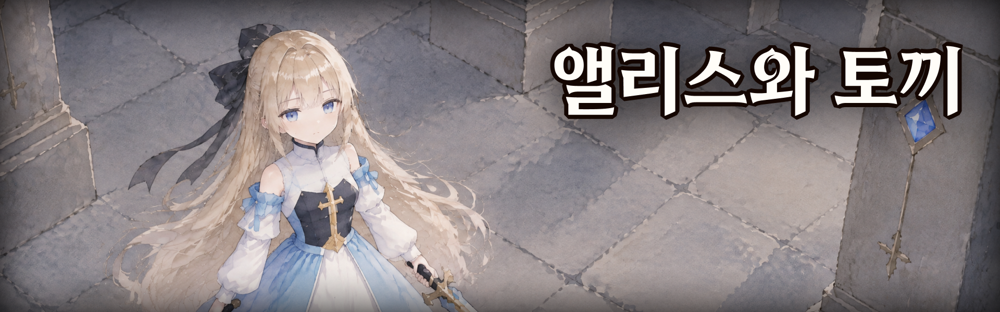
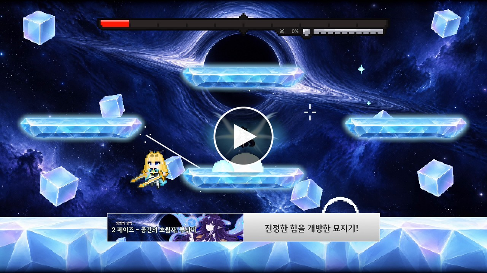
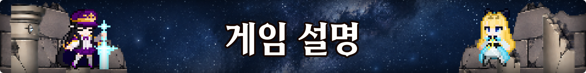
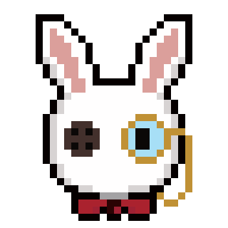
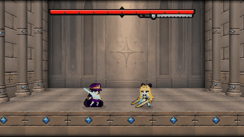
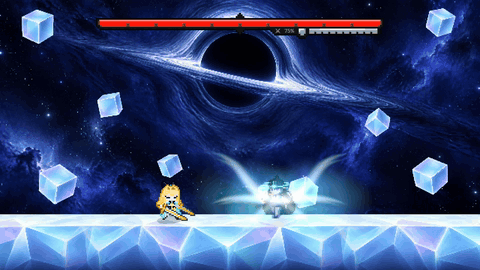
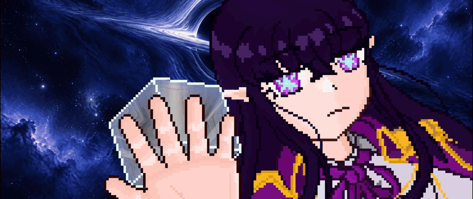
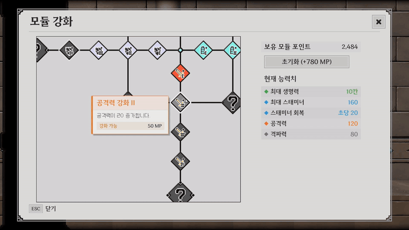
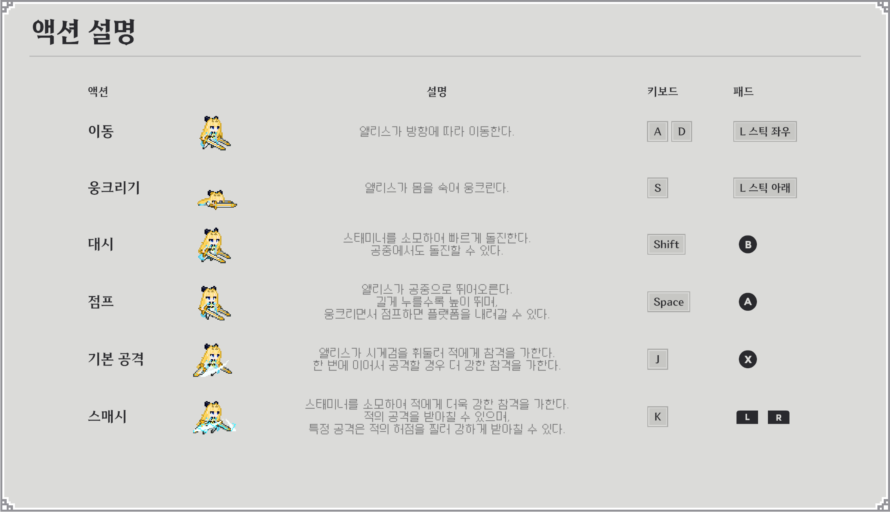
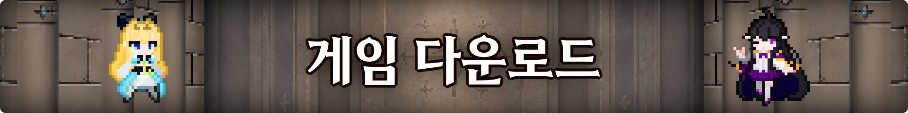

  

---

  

  

  ▲ 이미지를 누르면 YouTube에서 트레일러를 볼 수 있습니다.

---

  

###  한 줄 소개

> 어느날, 기억을 잃은 채 한 유적에서 깨어난 앨리스. 
> 그리고 그녀의 앞에 나타난 토끼 인형, 클록. 
> 과연 그들은 이 유적에서 빠져나갈 수 있을까요?

**앨리스와 토끼**는 앨리스를 조작하여 카운터-액션을 즐기는 **2D 사이드뷰 보스전 액션 게임**입니다.

###  받아치고, 무너뜨려라

<table><tr>
  <td width="50%"></td>
  <td width="50%"></td>
</tr></table>

보스의 공격이 닿는 바로 그 순간, 스매시로 받아치세요. 
정확한 카운터는 더 큰 피해를 입히고, 보스의 약점을 찔러 무너뜨릴 수 있습니다. 
패턴을 읽고, 받아치고, 몰아붙이는 손맛을 느껴 보세요.

###  픽셀 아트로 표현된 세상

앨리스의 몸짓 하나, 보스의 공격 하나까지 모두 도트로 그려 냈습니다. 
픽셀로 구현된 세상을 직접 확인하세요.

###  쓰러져도, 다음엔 더 강하게

보스가 너무 강하다고요? 걱정하지 마세요. 
다음에는 더욱 강해져서 도전할 수 있으니까요. 
도전할 때 마다 쌓이는 포인트를 사용해 능력치를 강화하고, 나만의 조합으로 다시 도전하세요.

###  그리고... 당신의 예상을 뒤엎을 기믹까지

싸움이 깊어질수록, 당신이 알던 **상식**은 조금씩 무너져 갑니다. 
그 순간이 오면, 부디 모니터에서 눈을 떼지 마세요.

###  액션 설명

키 설정은 게임 안 메뉴에서 바꿀 수 있습니다.

---

  

1. 위 이미지를 눌러 런처(`AliceAndRabbit_Launcher.exe`)를 받습니다.
2. 받은 파일을 실행합니다. 런처가 스스로 설치되고 바탕화면과 시작 메뉴에 **앨리스와 토끼** 바로 가기가 생깁니다.
3. 런처에서 **설치**를 누르면 최신 버전을 받아 설치합니다. 끝나면 **게임 시작**을 누릅니다.

- 다음부터는 바탕화면의 **앨리스와 토끼**를 켜면 됩니다. 새 버전이 나오면 런처에 **업데이트** 버튼이 뜹니다.
- Windows 10 / 11 (64비트) 전용입니다. 권장 해상도는 FHD(1920×1080)입니다. 따로 설치할 프로그램은 없습니다.
- 사용자 폴더(`%LOCALAPPDATA%\Programs\Alice & Rabbit`)에 설치되므로 관리자 권한을 묻지 않습니다.
- 처음 실행할 때 Windows SmartScreen 경고("Windows의 PC 보호")가 뜨면 **추가 정보 → 실행**을 누릅니다.
- 제거는 Windows 설정 > 앱 > 앨리스와 토끼, 또는 런처의 **제거** 버튼으로 합니다. 세이브는 남습니다.

---

## English

###  About

> One day, Alice wakes up in ancient ruins with no memory of who she is. 
> Before her stands a rabbit doll named Clock. 
> Can the two of them find their way out?

**Alice & Rabbit** is a **2D side-view boss-battle action game** where you play as Alice and master the art of the counter.

###  Counter, then break them down

The instant the boss's attack lands, answer it with a Smash. 
A precise counter slows time and strikes the boss's weak point, staggering them. 
Read the pattern, counter it, and press the advantage.

###  A world drawn in pixels

Every move Alice makes and every attack the boss throws is hand-drawn pixel art.

###  Fall, and come back stronger

Is the boss too strong? Don't worry. 
Every attempt earns points you can spend on upgrades, so build your own loadout and try again.

###  And gimmicks that defy your expectations

The deeper the fight goes, the more the rules you thought you knew start to crumble. 
When that moment comes, don't take your eyes off the screen.

###  Controls

The controls image above shows the keyboard and gamepad layouts. Key bindings can be changed in the in-game menu.

###  Download (English version)

**[Download the English launcher: `AliceAndRabbit_Launcher_EN.exe`](https://github.com/Fanteller/craft-on-team-Serendipity/releases/latest/download/AliceAndRabbit_Launcher_EN.exe)**

1. Download the launcher (`AliceAndRabbit_Launcher_EN.exe`) from the link above.
2. Run it. The launcher installs itself and adds an **Alice & Rabbit** shortcut to your desktop and Start menu.
3. In the launcher, press **Install** to download the latest version. When it finishes, press **Play**.

- From then on, just open **Alice & Rabbit** from your desktop. When a new version is out, the launcher shows an **Update** button.
- The English launcher starts the game in English. The Korean launcher (`AliceAndRabbit_Launcher.exe`) starts it in Korean. Both share the same game files.
- Windows 10 / 11 (64-bit) only. Recommended resolution is FHD (1920×1080). Nothing else needs to be installed.
- It installs to your user folder (`%LOCALAPPDATA%\Programs\Alice & Rabbit`), so it never asks for administrator rights.
- If Windows SmartScreen shows a warning ("Windows protected your PC") on first run, click **More info → Run anyway**.
- To uninstall, use Windows Settings > Apps > Alice & Rabbit, or the **Remove** button in the launcher. Your saves are kept.

---

  © 2026 Team Serendipity

