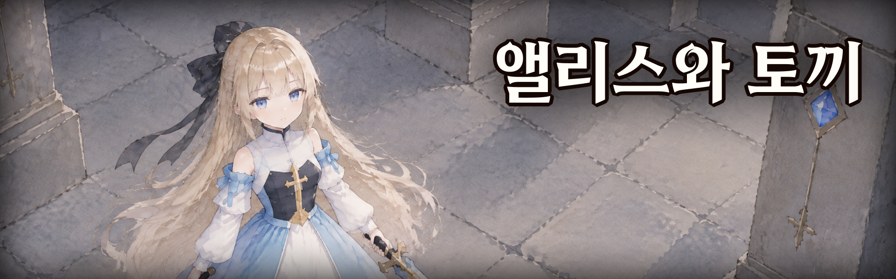
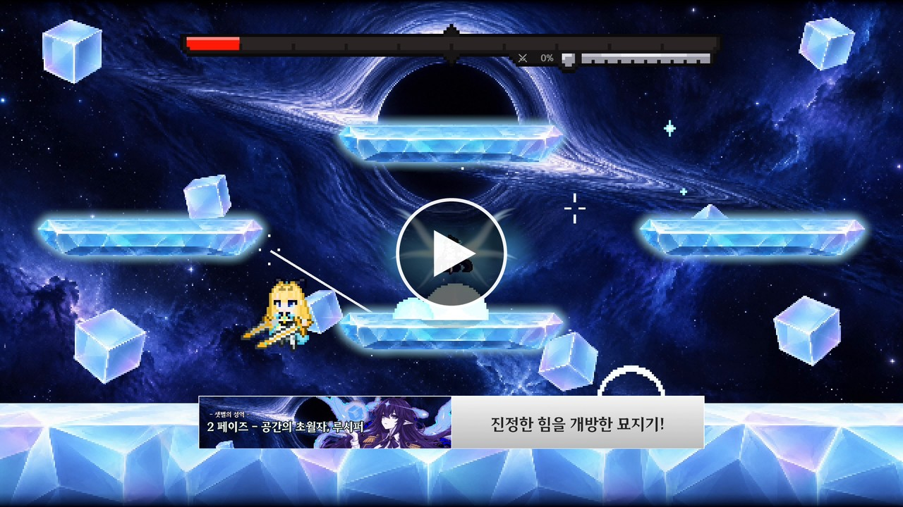
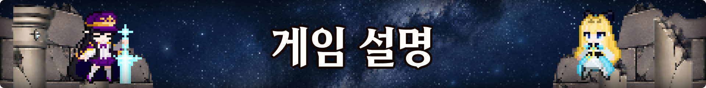
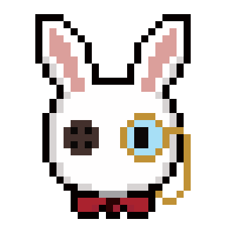
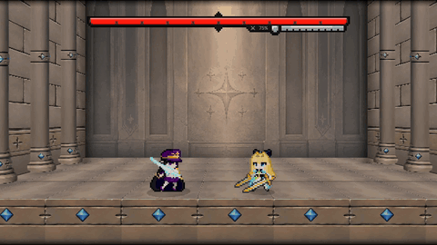
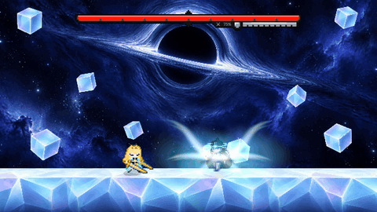
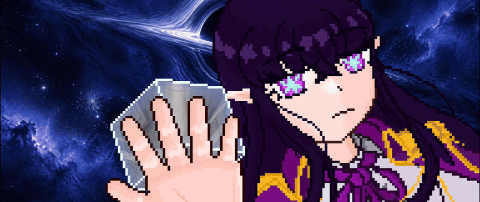
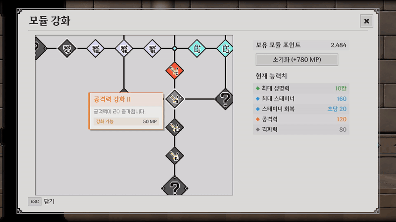
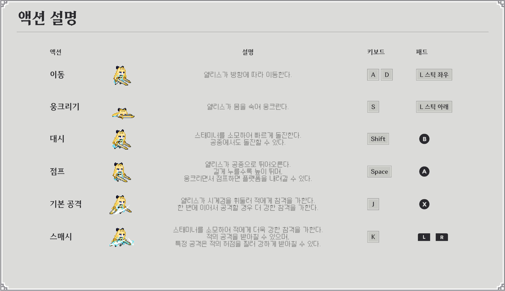
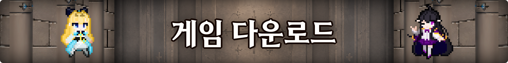

  

---

  

  

  ▶ 이미지를 누르면 YouTube에서 트레일러를 볼 수 있습니다.

---

  

###  한 줄 소개

> 어느날, 기억을 잃은 채 한 유적에서 깨어난 앨리스. 
> 그리고 그녀의 앞에 나타난 토끼 인형, 클록. 
> 과연 그들은 이 유적에서 빠져나갈 수 있을까요?

**앨리스와 토끼**는 앨리스를 조작하여 카운터-액션을 즐기는 **2D 사이드뷰 보스전 액션 게임**입니다.

###  받아치고, 무너뜨려라

<table><tr>
  <td width="50%"></td>
  <td width="50%"></td>
</tr></table>

보스의 공격이 닿는 바로 그 순간, 스매시로 받아치세요. 
정확한 카운터는 시간을 느리게 만들고, 보스의 약점을 찔러 무너뜨릴 수 있습니다. 
패턴을 읽고, 받아치고, 몰아붙이는 손맛을 느껴 보세요.

###  픽셀 아트로 표현된 세상

앨리스의 몸짓 하나, 보스의 공격 하나까지 모두 도트로 그려 냈습니다. 
픽셀로 구현된 세상을 직접 확인하세요.

###  쓰러져도, 다음엔 더 강하게

보스가 너무 강하다고요? 걱정하지 마세요. 
다음에는 더욱 강해져서 도전할 수 있으니까요. 
도전할 때 마다 쌓이는 포인트를 사용해 능력치를 강화하고, 나만의 조합으로 다시 도전하세요.

###  그리고... 당신의 예상을 뒤엎을 기믹까지

싸움이 깊어질수록, 당신이 알던 **상식**은 조금씩 무너져 갑니다. 
그 순간이 오면, 부디 모니터에서 눈을 떼지 마세요.

###  액션 설명

키 설정은 게임 안 메뉴에서 바꿀 수 있습니다.

---

  

1. 위 이미지를 눌러 런처(`AliceAndRabbit_Launcher.exe`)를 받습니다.
2. 받은 파일을 실행합니다. 런처가 스스로 설치되고 바탕화면과 시작 메뉴에 **앨리스와 토끼** 바로 가기가 생깁니다.
3. 런처에서 **설치**를 누르면 최신 버전을 받아 설치합니다. 끝나면 **게임 시작**을 누릅니다.

- 다음부터는 바탕화면의 **앨리스와 토끼**를 켜면 됩니다. 새 버전이 나오면 런처에 **업데이트** 버튼이 뜹니다.
- Windows 10 / 11 (64비트) 전용입니다. 권장 해상도는 FHD(1920×1080)입니다. 따로 설치할 프로그램은 없습니다.
- 사용자 폴더(`%LOCALAPPDATA%\Programs\Alice & Rabbit`)에 설치되므로 관리자 권한을 묻지 않습니다.
- 처음 실행할 때 Windows SmartScreen 경고("Windows의 PC 보호")가 뜨면 **추가 정보 → 실행**을 누릅니다.
- 제거는 Windows 설정 > 앱 > 앨리스와 토끼, 또는 런처의 **제거** 버튼으로 합니다. 세이브는 남습니다.

---

  © 2026 Team Serendipity

